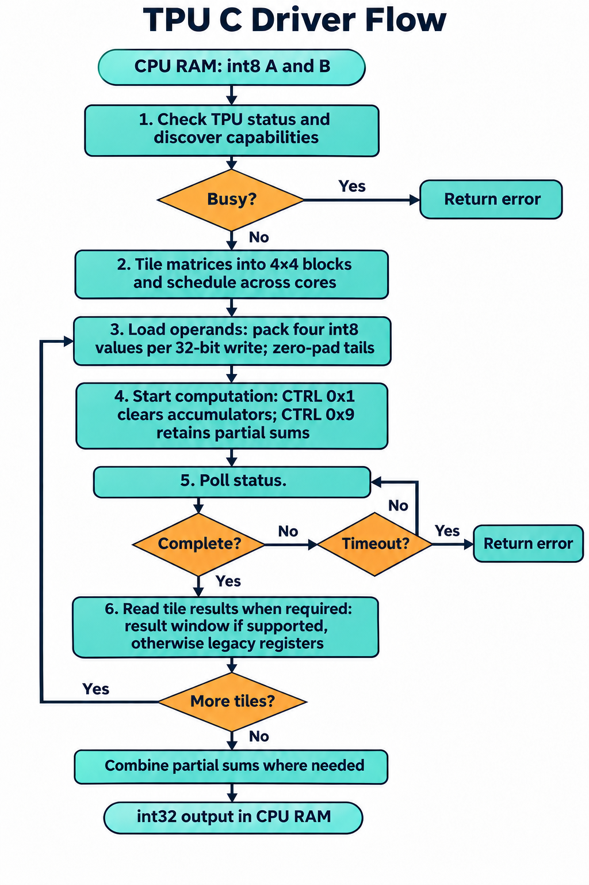

# tiny3tpu

this is my smallest-scale possible setup of creating the entire stack of a computer system from scratch. from the hardware design running to the front-end example running on this, its all written by me and my buddy (language models).


the current system looks like this

## hardware 
- VexRiscv CPU connected to a 8x4x4 systolic array core system, connected via AXI.
- each systolic core is a int8 MAC input with int32 accumalation width.

that's it. the cpu has a bram connected 64KiB over a 32-bit data bus. containing the entire program and necessary data, workspace, and stack.

## driver 
- its a baremetal c driver runs on VexRiscv. its main job is to move the work from cpu ram and start compute and copy results back.



## software

the application describes the math. our compiler turns that math into C code: some runs on the CPU, and some calls the driver to use the TPU.

all of this compilation happens on my computer before the program reaches the board.

### getting the math into the compiler

there are two ways in:

- **JAX:** export the calculation as StableHLO, a file describing the operations, array shapes, and types. our compiler reads that file.
- **tinygrad:** read the graph of operations that tinygrad builds from tensor code. we can also load an ONNX model through tinygrad and read the resulting graph.

this is the tinygrad work here: teaching our compiler to understand tinygrad's description of a calculation. this path goes straight into our compiler without needing StableHLO.

both paths become the same internal plan. think of it as a recipe: multiply these arrays, add this bias, apply this activation, return this result. it records which values each step needs and what it produces.

for example, tinygrad can describe matrix multiplication as lots of multiplications followed by sums. our frontend recognizes that pattern and turns it back into a matrix multiplication that the TPU can handle. it also recognizes supported convolutions and arranges image patches and filters as matrix products.

### what our compiler does with that plan

the shared compiler and backend turn the recipe into code for this hardware:

1. **check the calculation.** check that the shapes and types make sense and that we have an implementation for each operation. we currently support a subset of operations.
2. **remove unnecessary work.** calculate things that depend only on constants ahead of time, remove unused calculations, and combine suitable steps. for example, adding a bias and applying an activation can sometimes share one loop instead of storing a whole extra array between them.
3. **decide where the work runs.** CPU operations become ordinary C code. supported int8 matrix products can run on the CPU or call the TPU driver. `--gemm-policy auto` estimates the cost, including moving the data, and chooses. `cpu` or `tpu` forces the placement of those matrix products.
4. **plan temporary memory.** work out when each intermediate result is no longer needed so its space can be reused. this matters when the whole program and its data have to fit in 64KiB.
5. **prepare the TPU work.** constant matrices can be packed into the layout the driver needs ahead of time. for known matrix sizes, the backend can also generate a specialized kernel that schedules tiles across the cores and performs the register accesses.
6. **write the C.** emit the CPU calculations, accelerator calls, constants, and a workspace type for temporary storage.

for a calculation like `output = image × weights + bias`, the generated program might call the TPU driver for the matrix product, then run a CPU loop to add the bias. a small enough product might stay entirely on the CPU because sending it to the TPU would cost more than doing it directly.

placement is decided when we compile. inputs and loops can still change which steps execute and how often, but the driver does not choose where an operation runs.

### what actually runs on the board

the generated C is built together with the application firmware and driver using a RISC-V compiler and linker. the resulting program is converted into a `.hex` file used to initialize BRAM.

the firmware receives a request and calls the generated program with its inputs, output buffers, temporary workspace, and driver callbacks. the program executes its CPU code and calls the driver whenever it reaches a TPU operation. the firmware then sends the results back.

```text
JAX -> StableHLO -----------+
                           |
tinygrad tensor graph -----+--> shared plan -> our compiler -> generated C
          ^                                                       |
          |                                                       v
       ONNX model                             + application firmware + driver
                                                                  |
                                                                  v
                                                   RISC-V compiler and linker
                                                                  |
                                                                  v
                                                     firmware -> BRAM -> CPU
                                                                          |
                                                                          v
                                                                    driver -> TPU
```

the frontend code is in [stablehlo.py](tools/program/stablehlo.py) and [tinygrad_frontend.py](tools/program/tinygrad_frontend.py). the shared pipeline starts in [compiler.py](tools/program/compiler.py), placement is checked in [target.py](tools/program/target.py), and [c_backend.py](tools/program/c_backend.py) writes the C.

# decisions

## why did i decide to build such a setup?

from a project aim, i wanted to build a complete system which i could control to see what's the max push i could get out of just the fpga alone (i can definitely push more -- im working towards improving it)


there are many sidequests/research questions i have from this:


- what's the best setup in such a constrained area space?

there is no one answer to this. there are many types of possible ways to implement this. i really believe the best (and the most simplest ways to implement something which accelerates matrix math is systolic arrays). combine that with a cpu, and you get a full working system, a way to directly transport between the cpu and tpu-like system and you get a working system.

- what part of the stack really pushes through a performance?

all of performance (for a particular workload), can be provided from the custom compiler, the driver and the hardware. none of the overlaying stack matters that much, they have gotten good enough to produce generic code that i can assume they are performant enough for the workloads im aiming for.

- which stack is the most easiest to push performance?

easiest has to be the hardware scaling. which is kinda obvious if you think about it. the more the hardware scales, the more performance you get. raw hardware scale can improve the easiest to implement.

but it is also the most expensive. even in the small scale, i can't scale it to more than the current 8x4x4. its very difficult to push further than this because of the raw constraint of the fpga device itself. i might be able to do some floorplanning and shit to push some more compute, but it highly depends on.

on the other hand, it has become easier to work with software performance, give a good loop to an agent, and an idea to iterate towards with, and let it run overnight and you can get pure performance improvement from just the compiler work alone.


