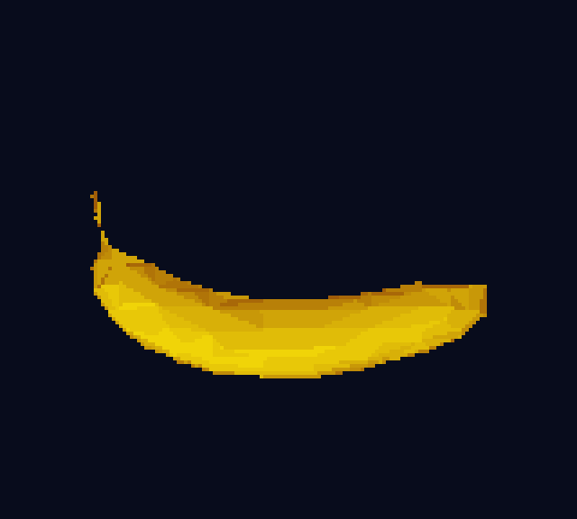

# tiny3tpu

A small TPU that runs on an FPGA. It can multiply matrices, recognize handwritten digits, move a banana, and help run cloth physics.

The project started with a 4×4 array of multiply-and-add units. It now has a small compiler that turns supported JAX / StableHLO programs into code for a RISC-V CPU and the TPU. The examples below have run on real hardware.

[Demo gallery](#demos) · [How it works](#how-it-works) · [Build and test](#build-and-test) · [Evidence and media](media/board-demos/README.md)

<a href="https://x.com/lazybanananann/status/2109297764739998109"></a>

**The FPGA is drawing this banana and sending it straight to HDMI.** This is footage of the real board and monitor. [Original post](https://x.com/lazybanananann/status/2109297764739998109) · [Original video](media/board-demos/hdmi-board.mp4)

## Demos

| Demo | Hardware | What was checked |
| --- | --- | --- |
| [HDMI banana](#banana-straight-to-hdmi) | KC705 | Board loaded; physical display footage |
| [Handheld banana](#banana-on-a-handheld) | ModRetro Chromatic | Board loaded; rotation confirmed on its LCD |
| [UART banana](#banana-through-a-host-viewer) | KC705 | Returned coordinates checked; 105 captured frames |
| [Digit classifier](#handwritten-digits) | KC705 | All logits checked for the first 20 MNIST test images |
| [Attention](#a-small-attention-block) | KC705 | All 64 output words checked; board cycles measured |
| [Cloth](#cloth-physics) | KC705 | State and coordinates checked; 51 captured frames |

Images are labeled by their source. A simulation preview is useful for seeing the pixels clearly, but the physical evidence is recorded separately.

### Banana straight to HDMI

The KC705 runs a compiled JAX program on its CPU. Two 4×4 int8 TPU cores transform the mesh. A hardware renderer draws **6,950 triangles at 640×480**, then sends the finished frame to HDMI. The computer is not supplying animated vertices or pixels. This image uses on-chip RAM, with no DDR.


*Pixel preview from RTL simulation. The footage above shows the physical monitor.*

The design runs at 25.2 MHz and refreshes HDMI at 60 Hz. The full-rotation simulation publishes a new image every other refresh: **30 frames per second**. That is a simulated rate, not a measurement taken from the camera clip.

[Source, build steps and controls](hardware/kc705_hdmi/README.md) · [Board load record](media/board-demos/evidence/hdmi-board-load.json) · [Full-rotation check](media/board-demos/evidence/hdmi-rtl.json)

### Banana on a handheld

The ModRetro Chromatic runs a smaller version on its own FPGA. One 4×4 TPU transforms 204 vertices; a hardware renderer draws 407 triangles for the 160×144 LCD. This version has no CPU and needs no host to draw the image.



*RTL preview. The physical board was programmed successfully, and rotation was confirmed on the handheld.*

[Source and controls](hardware/chromatic/README.md) · [Physical board record](media/board-demos/evidence/chromatic-board.json)

### Banana through a host viewer

In the earlier KC705 demo, the CPU updates the angle and the TPU transforms the mesh. The computer receives the coordinates over UART and draws the pixels. Board compute took about **29.6 ms per frame** in the saved run.


[Source and running instructions](sidequests/showcase/README.md) · [Capture record](media/showcase/gifs/banana-capture.json)

### Handwritten digits

A small **784 → 10** classifier recognizes MNIST digits. It was trained on the computer, then quantized to int8. The FPGA runs inference.


The quantized model reached **92.78% accuracy** on the separate 10,000-image test set, measured offline. We checked the first **20 images on the physical board**: 19 predictions were correct, and every returned logit matched the reference. The incorrect prediction is left in the GIF. Board compute took about **104 ms per image**; playback holds each digit longer so it is readable.

[Training and export](sidequests/showcase/train_classifier.py) · [Physical checks](media/showcase/evidence/classifier/physical-check.json) · [Weights and samples](media/showcase/evidence/classifier)

### A small attention block

This runs an 8-token, 8-feature attention block with six TPU matrix products. It uses synthetic weights to test the computation; it is not a pretrained language model.


A small CORDIC circuit computes exponential for softmax. It reduced the complete fixture's compute time by **12.6%**, with all 64 checked output words matching the reference. These times exclude UART and host drawing.

[CORDIC hardware](hardware/math) · [Physical measurements](media/showcase/evidence/physical-check.json)

### Cloth physics

The CPU runs the compiled physics step. The TPU transforms the resulting geometry, and the computer draws the returned coordinates.


This works, but it is slow: about **150 ms of compute for a 1/7680-second simulation step** in the captured run. The GIF speeds up playback. The CPU has no hardware floating-point unit, so this is not real-time cloth.

The physical regression checked 180 state words and 84 camera-coordinate words against the native generated-C reference for the tested requests.

[Source and running instructions](sidequests/cloth/README.md) · [Capture timings](media/showcase/gifs/cloth-capture.json)

## How it works


JAX exports the program on the development computer. The compiler reads StableHLO and generates RISC-V code plus accelerator calls. On the board, the CPU handles control flow and scalar math; the TPU handles supported matrix products.

The UART demos use a **100 MHz VexRiscv RV32IM CPU, two 4×4 int8 TPU cores, and 64 KiB of RAM**. The HDMI image uses **25.2 MHz and 256 KiB of CPU RAM**, plus separate display memory. The handheld uses a different, CPU-free design. These are separate FPGA images.

The compiler supports a subset of StableHLO. Arbitrary JAX programs still need supported operations, enough memory, and suitable numeric types. The published demos do not use DDR. Larger-memory, Ethernet, and MuJoCo display experiments are not included in this board-demo update.

## Build and test

Start with Python 3.12+, a C/C++ compiler and CMake. Install Verilator and Icarus Verilog for the RTL checks.

```sh
python3 -m venv .venv
.venv/bin/pip install -r tools/requirements-stablehlo.txt

cmake -S . -B build -DCMAKE_C_STANDARD=11 -DCMAKE_C_EXTENSIONS=OFF \
  -DPython3_EXECUTABLE="$PWD/.venv/bin/python"
cmake --build build -j4
ctest --test-dir build --output-on-failure
```

The full CPU/HDMI checks also need a RISC-V cross-compiler and the sibling [Synapse32](https://github.com/5iri/synapse32) checkout for its UART RTL. Board bitstreams need Yosys, nextpnr and the relevant device tools. See the [HDMI](hardware/kc705_hdmi/README.md) and [Chromatic](hardware/chromatic/README.md) guides for their exact paths and commands.

Compile an exported StableHLO program:

```sh
.venv/bin/python -m tools.program program.mlirbc \
  --target kc705-cordic --gemm-policy tpu \
  --math-mode freestanding --allow-approximation \
  -o program.h --report program-report.json
```

Select a target that matches your FPGA image. `kc705-cordic` needs the CORDIC peripheral; `kc705-direct` needs the direct TPU register interface used by the HDMI demo.

| Folder | Contents |
| --- | --- |
| [tools/program](tools/program) | StableHLO compiler |
| [multi-core](multi-core) and [systolic_array](systolic_array) | TPU hardware |
| [hardware/kc705_hdmi](hardware/kc705_hdmi) | Direct HDMI demo |
| [hardware/chromatic](hardware/chromatic) | Handheld demo |
| [sidequests/showcase](sidequests/showcase) | UART banana, classifier and attention |
| [sidequests/cloth](sidequests/cloth) | Compiled cloth physics |
| [media/board-demos](media/board-demos) | Gallery, original video, diagrams and evidence |

The original MNIST upload/draw tools remain in [pyfiles](pyfiles), with their older firmware in [firmware.c](firmware.c). Use the host tool that matches the programmed image.

### Shape-specific matrix kernels

The compiler now emits fixed-shape MMIO kernels for KC705 INT8 products. It
resolves core assignment, padding and tile addresses at compile time, packs
dynamic operands directly from its workspace, and writes results back there
without a separate accumulator copy. Small outer tile loops bound code size;
projections with the same shape and operand layout share a kernel. Constant
prepacking remains optional.

The direct targets use a separate cost model for these kernels. `auto` selects
the TPU for all four fixtures below. These are whole-program VexRiscv RTL cycles
at `-O2`, using the same RTL, input and reference outputs for every variant.
Attention retains CORDIC exponential in every variant. UART and host rendering
are excluded.

| Fixture | CPU matmuls | Generic direct TPU | Generated direct TPU | Gain over CPU |
| --- | ---: | ---: | ---: | ---: |
| Classifier, first sample | 378,115 | 845,575 | 193,610 | 1.95× |
| Banana, first transform | 298,751 | 435,169 | 243,198 | 1.23× |
| Attention + CORDIC | 1,168,118 | 1,228,342 | 1,097,692 | 1.06× |
| 16×256×16 product | 3,117,533 | 2,274,886 | 703,616 | 4.43× |

Every variant matched every output word. Mailbox placement stays conservative;
these direct-transport gains require the matching `DIRECT_TPU=1` hardware.
They are simulation results, with physical validation still pending.
The [measurement record](hardware/kc705_vexriscv/matmul_codegen_evidence.json)
records firmware sizes, source hashes and the individual comparisons.

For an exported fixture, reproduce CPU, automatic, generated-TPU and generic-TPU
comparisons with:

```bash
.venv/bin/python tests/profile_end_to_end.py \
  --artifact build-showcase/attention_block/program.mlirbc \
  --input build-showcase/attention_block/input.npy \
  --out build-matmul-specialization/attention-direct \
  --tpu-transport direct --optimization O2 --cordic --compare-generic
```

`CompileOptions(specialize_matmuls=False)` and `--no-specialize-matmuls` on the
compiler/SoC runner restore the generic path and its placement model. Compiler
reports list `specialized_matmuls` and `specialized_kernel_count`; SoC profiles
count actual `specialized_backend_calls`.

Embedding firmware opts in through the new optional backend field
`run_mmio_kernel=tiny3tpu_mmio_run_kernel`, with `user` pointing to its
`tiny3tpu_mmio`. Rebuild callers against the updated backend struct and initialize
this field to zero for other backends. Missing hooks or hardware without both
retained accumulation and the result window use the existing generic callbacks.
Bus errors and timeouts propagate without retrying a partly executed operation.

The combined direct showcase image passes 10 UART RTL requests, and the trained
classifier image passes 22, including all 20 samples. Both retain the linker's
4 KiB stack reservation. The combined image leaves only 72 additional bytes;
runtime peak stack remains unmeasured.

Matched UART-level comparisons now include CPU matmuls, the generic TPU driver,
and generated TPU kernels, all at `-O2` with direct transport. These times cover
the complete request/response, including application compute and UART traffic,
in 100 MHz RTL simulation. Attention retains CORDIC in every variant. The CPU
column is a separate reference; the speedup column compares the two TPU versions.

| Workload | CPU matmuls | Generic TPU | Generated TPU | TPU before/after gain |
| --- | ---: | ---: | ---: | ---: |
| Classifier, first sample | 4.76 ms | 9.31 ms | 2.97 ms | 3.14× |
| Attention + CORDIC | 15.01 ms | 15.73 ms | 14.29 ms | 1.10× |
| Banana, full payload | 30.28 ms | 31.69 ms | 29.71 ms | 1.07× |
| Banana, compact payload | 17.75 ms | 19.11 ms | 17.13 ms | 1.12× |

The full banana response spends about 27.26 ms outside application compute,
mostly on serial transfer, which limits the visible benefit of faster matrix
execution. Across the six firmware variants, all **96 requests** passed exact
output and backend-count checks, and native reference arrays matched across
all variants. See the [UART comparison evidence](hardware/kc705_vexriscv/matmul_end_to_end_evidence.json).
Both showcase firmware builders accept `--no-specialize-matmuls` to generate
the generic-driver baseline. These measurements exclude host OS/USB latency,
rendering, DDR3 and physical-board timing. The 16×256×16 fixture has compute-only
measurements above; its UART request/response time has not been measured.

## Sources and earlier writeups

The banana mesh comes from [SRA-VJTI/jaxsim](https://github.com/SRA-VJTI/jaxsim/blob/c0a097bba1c6db10cac7b359fbac11cfedc48c6b/examples/softras_simple_render.py). Chromatic board support is based on [ModRetro's FPGA sources](https://github.com/ModRetro/oss-chromatic-console-fpga/tree/8b4c965dc3a57fd4412836c136b5228a63c72803), with its license retained in the target directory. Media sources and processing steps are listed in the [asset guide](media/board-demos/README.md).

- [Tiny TPU in a Week](https://5iri.me/blog/tiny-tpu-week)
- [Update: tiny tpu is now bigger!](https://5iri.me/blog/tiny-tpu-is-now-bigger)
