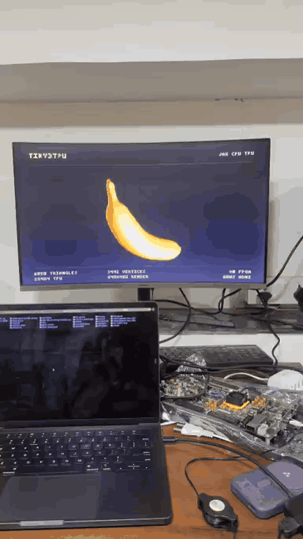
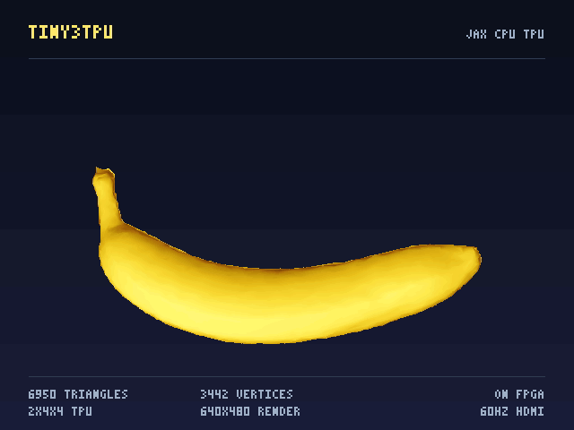
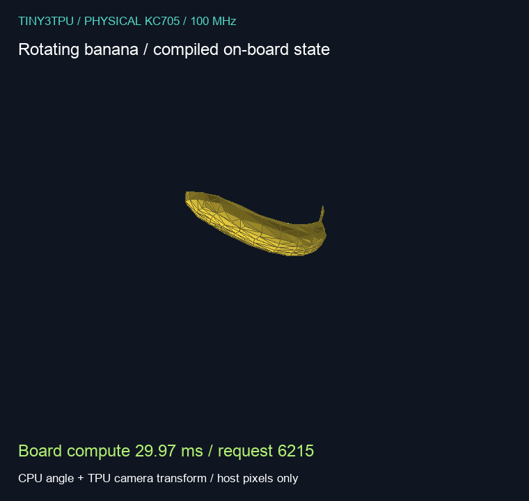
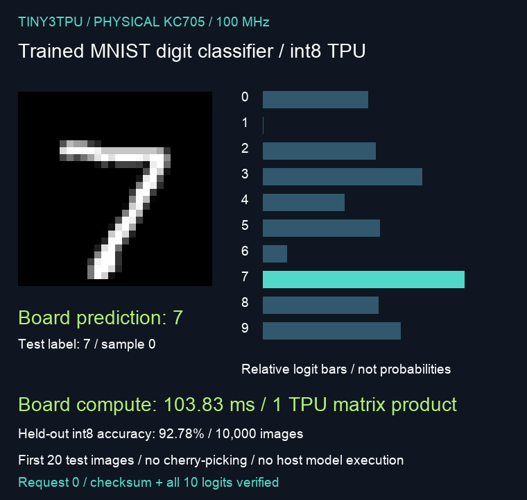
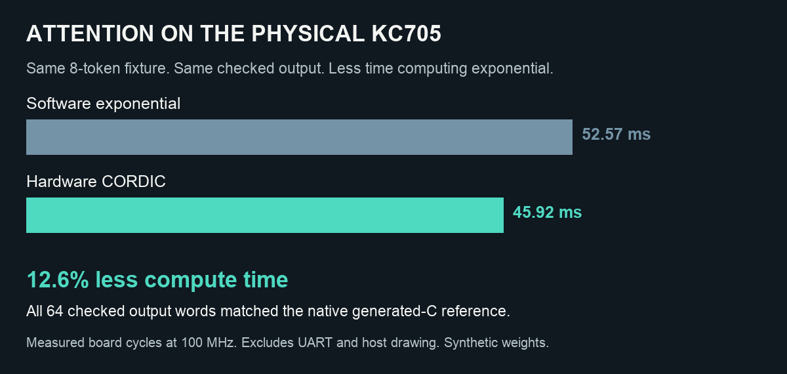
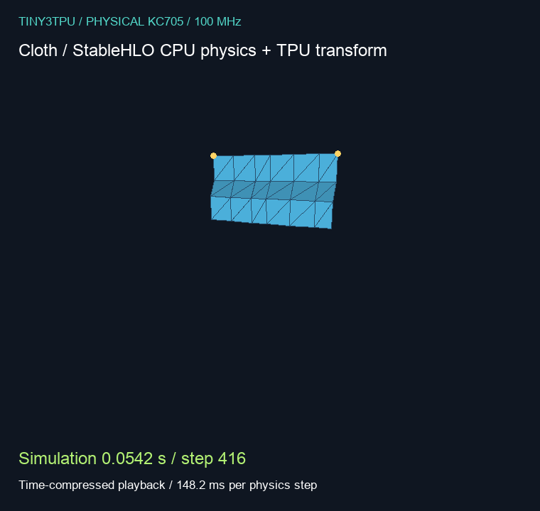
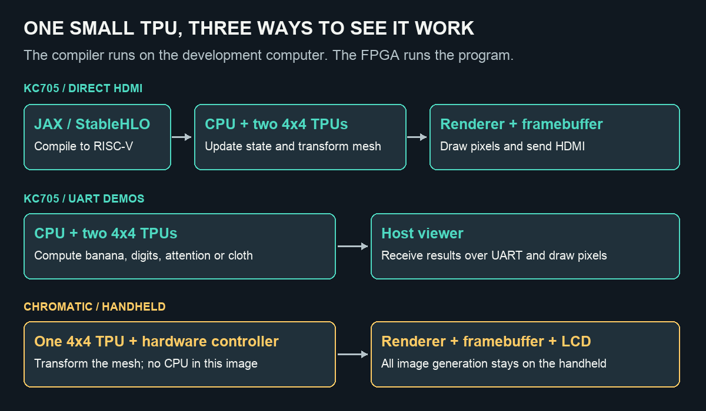

# tiny3tpu

A small TPU that runs on an FPGA. It can multiply matrices, recognize handwritten digits, move a banana, and help run cloth physics.

The project started with a 4×4 array of multiply-and-add units. It now has a small compiler that turns supported JAX / StableHLO programs into code for a RISC-V CPU and the TPU. The examples below have run on real hardware.

[Demo gallery](#demos) · [How it works](#how-it-works) · [Build and test](#build-and-test) · [Evidence and media](media/board-demos/README.md)

<a href="https://x.com/lazybanananann/status/2109297764739998109"></a>

**The FPGA is drawing this banana and sending it straight to HDMI.** This is footage of the real board and monitor. [Original post](https://x.com/lazybanananann/status/2109297764739998109) · [Original video](media/board-demos/hdmi-board.mp4)

## Demos

| Demo | Hardware | What was checked |
| --- | --- | --- |
| [HDMI banana](#banana-straight-to-hdmi) | KC705 | Board loaded; physical display footage |
| [UART banana](#banana-through-a-host-viewer) | KC705 | Returned coordinates checked; 105 captured frames |
| [Digit classifier](#handwritten-digits) | KC705 | All logits checked for the first 20 MNIST test images |
| [Attention](#a-small-attention-block) | KC705 | All 64 output words checked; board cycles measured |
| [Cloth](#cloth-physics) | KC705 | State and coordinates checked; 51 captured frames |

Images are labeled by their source. A simulation preview is useful for seeing the pixels clearly, but the physical evidence is recorded separately.

### Banana straight to HDMI

The KC705 runs a compiled JAX program on its CPU. Two 4×4 int8 TPU cores transform the mesh. A hardware renderer draws **6,950 triangles at 640×480**, then sends the finished frame to HDMI. The computer is not supplying animated vertices or pixels. This image uses on-chip RAM, with no DDR.



*Pixel preview from RTL simulation. The footage above shows the physical monitor.*

The design runs at 25.2 MHz and refreshes HDMI at 60 Hz. The full-rotation simulation publishes a new image every other refresh: **30 frames per second**. That is a simulated rate, not a measurement taken from the camera clip.

[Source, build steps and controls](hardware/kc705_hdmi/README.md) · [Board load record](media/board-demos/evidence/hdmi-board-load.json) · [Full-rotation check](media/board-demos/evidence/hdmi-rtl.json)

### Banana through a host viewer

In the earlier KC705 demo, the CPU updates the angle and the TPU transforms the mesh. The computer receives the coordinates over UART and draws the pixels. Board compute took about **29.6 ms per frame** in the saved run.



[Source and running instructions](sidequests/showcase/README.md) · [Capture record](media/showcase/gifs/banana-capture.json)

### Handwritten digits

A small **784 → 10** classifier recognizes MNIST digits. It was trained on the computer, then quantized to int8. The FPGA runs inference.



The quantized model reached **92.78% accuracy** on the separate 10,000-image test set, measured offline. We checked the first **20 images on the physical board**: 19 predictions were correct, and every returned logit matched the reference. The incorrect prediction is left in the GIF. Board compute took about **104 ms per image**; playback holds each digit longer so it is readable.

[Training and export](sidequests/showcase/train_classifier.py) · [Physical checks](media/showcase/evidence/classifier/physical-check.json) · [Weights and samples](media/showcase/evidence/classifier)

### A small attention block

This runs an 8-token, 8-feature attention block with six TPU matrix products. It uses synthetic weights to test the computation; it is not a pretrained language model.



A small CORDIC circuit computes exponential for softmax. It reduced the complete fixture's compute time by **12.6%**, with all 64 checked output words matching the reference. These times exclude UART and host drawing.

[CORDIC hardware](hardware/math) · [Physical measurements](media/showcase/evidence/physical-check.json)

### Cloth physics

The CPU runs the compiled physics step. The TPU transforms the resulting geometry, and the computer draws the returned coordinates.



This works, but it is slow: about **150 ms of compute for a 1/7680-second simulation step** in the captured run. The GIF speeds up playback. The CPU has no hardware floating-point unit, so this is not real-time cloth.

The physical regression checked 180 state words and 84 camera-coordinate words against the native generated-C reference for the tested requests.

[Source and running instructions](sidequests/cloth/README.md) · [Capture timings](media/showcase/gifs/cloth-capture.json)

## How it works



JAX exports the program on the development computer. The compiler reads StableHLO and generates RISC-V code plus accelerator calls. On the board, the CPU handles control flow and scalar math; the TPU handles supported matrix products.

The UART demos use a **100 MHz VexRiscv RV32IM CPU, two 4×4 int8 TPU cores, and 64 KiB of RAM**. The HDMI image uses **25.2 MHz and 256 KiB of CPU RAM**, plus separate display memory. These are separate FPGA images.

The compiler supports a subset of StableHLO. Arbitrary JAX programs still need supported operations, enough memory, and suitable numeric types. The published demos do not use DDR. Ethernet, MJX learning, the Chromatic target, and the tinygrad/ONNX frontend are maintained on the feature branches listed below.

## Build and test

Start with Python 3.12+, a C/C++ compiler and CMake. Install Verilator and Icarus Verilog for the RTL checks.

```sh
python3 -m venv .venv
.venv/bin/pip install -r tools/requirements-stablehlo.txt

cmake -S . -B build -DCMAKE_C_STANDARD=11 -DCMAKE_C_EXTENSIONS=OFF \
  -DPython3_EXECUTABLE="$PWD/.venv/bin/python"
cmake --build build -j4
ctest --test-dir build --output-on-failure
```

The full CPU/HDMI checks also need a RISC-V cross-compiler and the sibling [Synapse32](https://github.com/5iri/synapse32) checkout for its UART RTL. Board bitstreams need Yosys, nextpnr and the relevant device tools. See the [HDMI](hardware/kc705_hdmi/README.md) and [Chromatic](hardware/chromatic/README.md) guides for their exact paths and commands.

Compile an exported StableHLO program:

```sh
.venv/bin/python -m tools.program program.mlirbc \
  --target kc705-cordic --gemm-policy tpu \
  --math-mode freestanding --allow-approximation \
  -o program.h --report program-report.json
```

Select a target that matches your FPGA image. `kc705-cordic` needs the CORDIC peripheral; `kc705-direct` needs the direct TPU register interface used by the HDMI demo.

| Folder | Contents |
| --- | --- |
| [tools/program](tools/program) | StableHLO compiler |
| [multi-core](multi-core) and [systolic_array](systolic_array) | TPU hardware |
| [hardware/kc705_hdmi](hardware/kc705_hdmi) | Direct HDMI demo |
| [hardware/chromatic](hardware/chromatic) | Handheld demo |
| [sidequests/showcase](sidequests/showcase) | UART banana, classifier and attention |
| [sidequests/cloth](sidequests/cloth) | Compiled cloth physics |
| [media/board-demos](media/board-demos) | Gallery, original video, diagrams and evidence |

The original MNIST upload/draw tools remain in [pyfiles](pyfiles), with their older firmware in [firmware.c](firmware.c). Use the host tool that matches the programmed image.

### Shape-specific matrix kernels

The compiler now emits fixed-shape MMIO kernels for KC705 INT8 products. It
resolves core assignment, padding and tile addresses at compile time, packs
dynamic operands directly from its workspace, and writes results back there
without a separate accumulator copy. Small outer tile loops bound code size;
projections with the same shape and operand layout share a kernel. Constant
prepacking remains optional.

The direct targets use a separate cost model for these kernels. `auto` selects
the TPU for all four fixtures below. These are whole-program VexRiscv RTL cycles
at `-O2`, using the same RTL, input and reference outputs for every variant.
Attention retains CORDIC exponential in every variant. UART and host rendering
are excluded.

| Fixture | CPU matmuls | Generic direct TPU | Generated direct TPU | Gain over CPU |
| --- | ---: | ---: | ---: | ---: |
| Classifier, first sample | 378,115 | 845,575 | 193,610 | 1.95× |
| Banana, first transform | 298,751 | 435,169 | 243,198 | 1.23× |
| Attention + CORDIC | 1,168,118 | 1,228,342 | 1,097,692 | 1.06× |
| 16×256×16 product | 3,117,533 | 2,274,886 | 703,616 | 4.43× |

Every variant matched every output word. Mailbox placement stays conservative;
these direct-transport gains require the matching `DIRECT_TPU=1` hardware.
They are simulation results, with physical validation still pending.
The [measurement record](hardware/kc705_vexriscv/matmul_codegen_evidence.json)
records firmware sizes, source hashes and the individual comparisons.

For an exported fixture, reproduce CPU, automatic, generated-TPU and generic-TPU
comparisons with:

```bash
.venv/bin/python tests/profile_end_to_end.py \
  --artifact build-showcase/attention_block/program.mlirbc \
  --input build-showcase/attention_block/input.npy \
  --out build-matmul-specialization/attention-direct \
  --tpu-transport direct --optimization O2 --cordic --compare-generic
```

`CompileOptions(specialize_matmuls=False)` and `--no-specialize-matmuls` on the
compiler/SoC runner restore the generic path and its placement model. Compiler
reports list `specialized_matmuls` and `specialized_kernel_count`; SoC profiles
count actual `specialized_backend_calls`.

Embedding firmware opts in through the new optional backend field
`run_mmio_kernel=tiny3tpu_mmio_run_kernel`, with `user` pointing to its
`tiny3tpu_mmio`. Rebuild callers against the updated backend struct and initialize
this field to zero for other backends. Missing hooks or hardware without both
retained accumulation and the result window use the existing generic callbacks.
Bus errors and timeouts propagate without retrying a partly executed operation.

The combined direct showcase image passes 10 UART RTL requests, and the trained
classifier image passes 22, including all 20 samples. Both retain the linker's
4 KiB stack reservation. The combined image leaves only 72 additional bytes;
runtime peak stack remains unmeasured.

Matched UART-level comparisons now include CPU matmuls, the generic TPU driver,
and generated TPU kernels, all at `-O2` with direct transport. These times cover
the complete request/response, including application compute and UART traffic,
in 100 MHz RTL simulation. Attention retains CORDIC in every variant. The CPU
column is a separate reference; the speedup column compares the two TPU versions.

| Workload | CPU matmuls | Generic TPU | Generated TPU | TPU before/after gain |
| --- | ---: | ---: | ---: | ---: |
| Classifier, first sample | 4.76 ms | 9.31 ms | 2.97 ms | 3.14× |
| Attention + CORDIC | 15.01 ms | 15.73 ms | 14.29 ms | 1.10× |
| Banana, full payload | 30.28 ms | 31.69 ms | 29.71 ms | 1.07× |
| Banana, compact payload | 17.75 ms | 19.11 ms | 17.13 ms | 1.12× |

The full banana response spends about 27.26 ms outside application compute,
mostly on serial transfer, which limits the visible benefit of faster matrix
execution. Across the six firmware variants, all **96 requests** passed exact
output and backend-count checks, and native reference arrays matched across
all variants. See the [UART comparison evidence](hardware/kc705_vexriscv/matmul_end_to_end_evidence.json).
Both showcase firmware builders accept `--no-specialize-matmuls` to generate
the generic-driver baseline. These measurements exclude host OS/USB latency,
rendering, DDR3 and physical-board timing. The 16×256×16 fixture has compute-only
measurements above; its UART request/response time has not been measured.

## Sources and earlier writeups

The banana mesh comes from [SRA-VJTI/jaxsim](https://github.com/SRA-VJTI/jaxsim/blob/c0a097bba1c6db10cac7b359fbac11cfedc48c6b/examples/softras_simple_render.py). Chromatic board support is based on [ModRetro's FPGA sources](https://github.com/ModRetro/oss-chromatic-console-fpga/tree/8b4c965dc3a57fd4412836c136b5228a63c72803), with its license retained in the target directory. Media sources and processing steps are listed in the [asset guide](media/board-demos/README.md).

- [Tiny TPU in a Week](https://5iri.me/blog/tiny-tpu-week)
- [Update: tiny tpu is now bigger!](https://5iri.me/blog/tiny-tpu-is-now-bigger)

## Current compiler and runtime work

The current source extends the accelerator to eight 4×4 INT8 cores with retained
INT32 accumulation, broadcast operand apertures, and direct result reads. The
compiler emits shape-specific MMIO kernels and chooses CPU or TPU execution
using explicit cost estimates. Constant prepacking and generic backend fallbacks
remain available. An MMIO floating-point peripheral and freestanding math hooks
are also included. These sources require matching rebuilt hardware and firmware;
the physical demo measurements above describe their saved earlier images.

The general HDMI framebuffer path supports CPU-written RGB565 images, double
buffering, and VGA or 720p scanout. Higher-resolution synthesis and RTL results
do not establish routed timing or physical operation. See
[the HDMI guide](hardware/kc705_hdmi/README.md).

## Feature branches

| Work | Branch |
| --- | --- |
| Chromatic handheld target | [`feat/modretro-banana`](https://github.com/5iri/tiny3tpu/tree/feat/modretro-banana) |
| Hardware Ethernet and mesh capacity studies | [`feat/ethernet`](https://github.com/5iri/tiny3tpu/tree/feat/ethernet) |
| MJX learning and MuJoCo rendering | [`feat/mjx-learning`](https://github.com/5iri/tiny3tpu/tree/feat/mjx-learning) |
| tinygrad/ONNX model frontend | [`feat/tinygrad-openpilot`](https://github.com/5iri/tiny3tpu/tree/feat/tinygrad-openpilot) |

## Recorded optimization measurements

The following records describe the earlier two-core implementation and its
matching firmware. They are retained as historical comparisons; they are not
benchmarks of the current eight-core source or MMIO FPU.

### Accumulation and transport measurements

The RTL now supports retaining each core's partial sums across K tiles. An ordinary
`CTRL.START` (`0x1`) clears the accumulators as before; `0x9` starts another tile
while retaining them. Read-only `STATUS` bit 8 advertises this capability. The
generic MMIO driver detects it through the existing status read and reads results
after the final K tile. K-parallel work still combines the two final core sums on
the CPU. For `K > 131071`, the driver retains per-tile readback and int64 CPU
accumulation so intermediate int32 overflow cannot change the result contract.
Older bitstreams return zero for the capability and use the original path.

The AXI and AXIS C/RTL checks produce `accumulation-profile.json` in their build
directories. They compare the same RTL and inputs with the capability visible or
masked, checking every output against an independent int64 reference. Reports
separate operand, launch, polling and result-access transactions and simulation
cycles. The C driver runs on the host in these tests, so those cycles exclude
VexRiscv packing, software arithmetic and instruction execution. They are not
board timings. To generate the reports:

```bash
ctest --test-dir build -R '^tiny3tpu_(mmio_rtl|axis_mailbox_rtl)$' --output-on-failure
```

The deterministic shape fixtures give these AXIS mailbox results. Each result
value costs four register transactions (selector, read command, low and high
word); the cycle column includes all operand, launch, polling and result traffic.
Attention totals cover six GEMMs. These fixtures use synthetic operands, not the
trained classifier weights or complete application code.

| Fixture (M, K, N) | Result transactions, legacy → retained | Transport cycles, legacy → retained |
| --- | ---: | ---: |
| Classifier (1, 784, 10) | 7,840 → 80 | 202,890 → 90,370 |
| Attention (8, 8, 8), six calls | 3,072 → 1,536 | 54,636 → 32,364 |
| Banana transform (204, 3, 3) | 2,448 → 2,448 | 42,552 → 42,552 |
| Cloth camera (28, 3, 3) | 336 → 336 | 6,098 → 6,098 |

For full VexRiscv-plus-TPU simulation, `tests/test_stablehlo_soc.py --profile`
reports the whole generated program and time inside its QGEMM callbacks. Add
`--legacy-accumulation` to mask the accelerator capability for an A/B comparison.
The callback timer includes CPU packing, polling and sum merging as well as
transport and accelerator execution. For an already exported attention fixture:

```bash
python3 tests/test_stablehlo_soc.py --out build/soc-attention-auto \
  --artifact build-showcase/attention_block/program.mlirbc \
  --input build-showcase/attention_block/input.npy --no-affine --cordic --profile --gemm-policy tpu \
  --legacy-result-reads --no-prepack-constants
python3 tests/test_stablehlo_soc.py --out build/soc-attention-legacy \
  --artifact build-showcase/attention_block/program.mlirbc \
  --input build-showcase/attention_block/input.npy --no-affine --cordic --profile --gemm-policy tpu \
  --legacy-accumulation --legacy-result-reads --no-prepack-constants
```

Before the result-window and constant-packing changes below, the showcase
attention input with CORDIC enabled gave 4,988,137 → 3,126,237 whole-program
cycles (37.3% fewer), and
3,664,912 → 1,828,729 QGEMM callback cycles. Both modes made six backend calls
and matched all 64 float32 output words against the native reference. These
figures compare separately compiled firmware on the same updated simulated RTL;
the legacy run masks the capability in its accelerator-read callback.

Existing demo timings above were measured with the earlier bitstreams. Using
retained accumulation on the board requires rebuilding, routing and validating a
new image.

### Result reads and constant packing

`STATUS` bit 9 advertises a read-only result window. An aligned read at
`0x80 + core*64 + row*16 + column*4` returns one signed INT32 result, replacing
the four legacy selector/command/low/high transactions. This is a window of
individual AXI-Lite reads, not an AXI burst. Busy reads, writes to the window and
unaligned accesses return bus errors. The driver detects this capability
independently of accumulation and keeps the legacy readback path for older RTL.

The StableHLO compiler now emits padded 4x4 row words for constant INT8 matrix
operands, including separate matrices in a batch. An optional backend
`run_packed` callback consumes these words directly; the generated program uses
the original `run` callback when packing is unsupported. Dynamic operands keep
the existing path. Use `CompileOptions(prepack_constants=False)` or the compiler
CLI's `--no-prepack-constants` to disable this optimization.

The callback extends `tiny3tpu_qgemm_backend`: rebuild callers against the new
header (the struct's binary layout changed) and initialize `run_packed` to zero
if unsupported. The compiler report's
`packed_constant_bytes` is additional static storage, separate from raw
`constant_bytes`, `tpu_weight_bytes` and `map_bytes`. Raw constants and packing
scratch remain available for fallback; prepacking trades some static storage
for less CPU work.

The RTL transaction report now compares legacy, accumulation-only and result
window modes on the same RTL. A separate full-SoC runner measures all four
combinations of result reads and constant packing, with accumulation enabled
throughout, and saves `comparison.json` plus each firmware's size and profile:

```bash
python3 tests/profile_data_movement.py --out build/data-movement-attention \
  --artifact build-showcase/attention_block/program.mlirbc \
  --input build-showcase/attention_block/input.npy --cordic
```

Omit `--artifact` and `--input` for the built-in smoke workload. The underlying
SoC harness also accepts `--legacy-result-reads` and `--no-prepack-constants`
individually. Reports count packed backend calls to confirm the optimized path
executed. All timings are simulated CPU-plus-TPU cycles; physical timing still
requires routing and board validation.

Measured whole-program cycles, using the same updated RTL and separately
compiled firmware for each mode:

| Workload | Accumulation only | Result window only | Prepacking only | Both |
| --- | ---: | ---: | ---: | ---: |
| Attention + CORDIC | 3,202,891 | 2,089,326 | 3,127,050 | 2,044,179 |
| Trained classifier, first sample | 3,752,853 | 3,646,604 | 3,629,079 | 3,514,573 |
| Banana transform application | 2,472,193 | 1,100,284 | 2,474,390 | 1,103,627 |

Every mode matched the native reference bit-for-bit: 64 attention, 10 classifier
and 613 banana output words. Packing was used for four, one and one backend
calls respectively. The result window produces the largest gain for attention
and banana; packing gives smaller gains for attention and the classifier, and
slightly increases cycles for this small-K banana workload. The opt-out flag
allows selecting the cheaper variant. These are current-driver comparisons,
not an assertion that earlier firmware binaries have identical baseline costs.

### End-to-end throughput improvements

The default KC705 compiler policy is now `--gemm-policy auto`. It estimates the
complete INT8 matrix operation, including packing, transport and result reads,
and selects CPU or TPU with a 15% margin. `cpu` and `tpu` force either exact
implementation. Reports include placement, cost estimates and actual backend
counts; the live viewers display the selected execution path.

Whole-program VexRiscv RTL measurements at 100 MHz, comparing the audited
`-Os`/TPU firmware above with `auto`/`-O2` and the updated CPU math:

| Workload | Before | Updated | Compute throughput gain |
| --- | ---: | ---: | ---: |
| Classifier, first sample | 35.146 ms | 3.782 ms | 9.29× |
| Banana, first transform | 11.036 ms | 2.985 ms | 3.70× |
| Attention + CORDIC | 20.442 ms | 11.738 ms | 1.74× |
| Cloth, first physics step | 111.431 ms | 84.518 ms | 1.32× |

These isolated compute measurements exclude UART and host rendering. All output
words match independently executed generated C. The small INT8 products run on
the CPU in these automatic builds; CORDIC still executes exponential operations
in hardware. The four workloads fit the existing 64 KiB RAM with the linker
reserving 4 KiB for stack. Firmware builders report the remaining static margin;
peak runtime stack is not measured.

The core operand scratchpads now receive writes directly, removing the duplicate
buffer and its 64-cycle copy. A full two-core launch takes 20 controller cycles
instead of 84. The driver chooses row, K or output-column splitting; a 4×4×8
product uses one launch. Separate column and row/K code paths keep the extra
scheduling logic out of the hot instruction-cache footprint.

An optional native register transport maps one CPU access to one AXI-Lite access.
It requires freshly synthesized hardware with `DIRECT_TPU=1` and matching
`--tpu-transport direct` firmware. The legacy mailbox remains the default ABI.
Use compiler targets `kc705-direct` or `kc705-direct-cordic` for its cost model.
Before shape specialization, a 16×256×16 product on direct transport took
22.741 ms versus 31.175 ms on the CPU, with all 256 outputs exact. Full no-DDR
VexRiscv/CORDIC/direct-TPU synthesis passes and still uses 32 DSPs, 16 RAMB36s and
4 RAMB18s. Routing and physical validation remain pending.

### Shape-specific matrix kernels

The compiler now emits fixed-shape MMIO kernels for KC705 INT8 products. It
resolves core assignment, padding and tile addresses at compile time, packs
dynamic operands directly from its workspace, and writes results back there
without a separate accumulator copy. Small outer tile loops bound code size;
projections with the same shape and operand layout share a kernel. Constant
prepacking remains optional.

The direct targets use a separate cost model for these kernels. `auto` selects
the TPU for all four fixtures below. These are whole-program VexRiscv RTL cycles
at `-O2`, using the same RTL, input and reference outputs for every variant.
Attention retains CORDIC exponential in every variant. UART and host rendering
are excluded.

| Fixture | CPU matmuls | Generic direct TPU | Generated direct TPU | Gain over CPU |
| --- | ---: | ---: | ---: | ---: |
| Classifier, first sample | 378,115 | 845,575 | 193,610 | 1.95× |
| Banana, first transform | 298,751 | 435,169 | 243,198 | 1.23× |
| Attention + CORDIC | 1,168,118 | 1,228,342 | 1,097,692 | 1.06× |
| 16×256×16 product | 3,117,533 | 2,274,886 | 703,616 | 4.43× |

Every variant matched every output word. Mailbox placement stays conservative;
these direct-transport gains require the matching `DIRECT_TPU=1` hardware.
They are simulation results, with physical validation still pending.
The [measurement record](hardware/kc705_vexriscv/matmul_codegen_evidence.json)
records firmware sizes, source hashes and the individual comparisons.

For an exported fixture, reproduce CPU, automatic, generated-TPU and generic-TPU
comparisons with:

```bash
.venv/bin/python tests/profile_end_to_end.py \
  --artifact build-showcase/attention_block/program.mlirbc \
  --input build-showcase/attention_block/input.npy \
  --out build-matmul-specialization/attention-direct \
  --tpu-transport direct --optimization O2 --cordic --compare-generic
```

`CompileOptions(specialize_matmuls=False)` and `--no-specialize-matmuls` on the
compiler/SoC runner restore the generic path and its placement model. Compiler
reports list `specialized_matmuls` and `specialized_kernel_count`; SoC profiles
count actual `specialized_backend_calls`.

Embedding firmware opts in through the new optional backend field
`run_mmio_kernel=tiny3tpu_mmio_run_kernel`, with `user` pointing to its
`tiny3tpu_mmio`. Rebuild callers against the updated backend struct and initialize
this field to zero for other backends. Missing hooks or hardware without both
retained accumulation and the result window use the existing generic callbacks.
Bus errors and timeouts propagate without retrying a partly executed operation.

The combined direct showcase image passes 10 UART RTL requests, and the trained
classifier image passes 22, including all 20 samples. Both retain the linker's
4 KiB stack reservation. The combined image leaves only 72 additional bytes;
runtime peak stack remains unmeasured.

Matched UART-level comparisons now include CPU matmuls, the generic TPU driver,
and generated TPU kernels, all at `-O2` with direct transport. These times cover
the complete request/response, including application compute and UART traffic,
in 100 MHz RTL simulation. Attention retains CORDIC in every variant. The CPU
column is a separate reference; the speedup column compares the two TPU versions.

| Workload | CPU matmuls | Generic TPU | Generated TPU | TPU before/after gain |
| --- | ---: | ---: | ---: | ---: |
| Classifier, first sample | 4.76 ms | 9.31 ms | 2.97 ms | 3.14× |
| Attention + CORDIC | 15.01 ms | 15.73 ms | 14.29 ms | 1.10× |
| Banana, full payload | 30.28 ms | 31.69 ms | 29.71 ms | 1.07× |
| Banana, compact payload | 17.75 ms | 19.11 ms | 17.13 ms | 1.12× |

The full banana response spends about 27.26 ms outside application compute,
mostly on serial transfer, which limits the visible benefit of faster matrix
execution. Across the six firmware variants, all **96 requests** passed exact
output and backend-count checks, and native reference arrays matched across
all variants. See the [UART comparison evidence](hardware/kc705_vexriscv/matmul_end_to_end_evidence.json).
Both showcase firmware builders accept `--no-specialize-matmuls` to generate
the generic-driver baseline. These measurements exclude host OS/USB latency,
rendering, DDR3 and physical-board timing. The 16×256×16 fixture has compute-only
measurements above; its UART request/response time has not been measured.

Banana responses can use a lossless, independently decodable coordinate packet:
angle float32, three signed INT32 bases, then UINT16 XYZ offsets. Unsupported
values fall back to the original float32 payload. The host requests it with
mode bit 31, recognizes word-count bit 31 in the response, verifies the checksum
over reconstructed float32 words, and retries the original request once when
older firmware rejects the feature. Responses shrink from 2,480 to 1,268 bytes.
The production firmware UART simulation measured **31.330 ms raw versus
18.838 ms compact** per banana round trip, including CPU execution and UART.
These are consecutive poses in the same run; every output word is checked.
They exclude host rendering and are not physical USB/board measurements.

The three live viewers acquire and validate responses independently of rendering,
retain only the latest result per mode, and report acquisition versus display
rates. Classifier presentation has no forced 600 ms delay; GIF capture is opt-in.
Browser refresh is no longer capped at 150–350 ms. Use `--raw-uart` to disable
compact banana responses and `--board` to select the programmed image's manifest.

CPU square root now uses correctly rounded integer binary32 arithmetic instead
of five software float divisions. Atan coefficients are constants and sin/cos
avoid unnecessary work. Square-root rounding can differ from the previous
approximation by 1 ULP, which changes long cloth trajectories: after 11,520
steps, the measured new/old position difference reaches 9.74 cm. Compile with
`-DTINY3TPU_LEGACY_SQRT=1` to reproduce the historical rounding. Both paths retain
NaN, infinity, signed-zero and subnormal handling. Exhaustive sqrt significand
tests and long-run numerical evidence are included in the validation.

Rebuild firmware without retraining or FPGA tools, then run whole-packet RTL
validation (the existing exported artifacts and samples must be present):

```bash
python3 sidequests/showcase/build_board.py --out build/showcase-fast \
  --gemm-policy auto --optimization O2
python3 sidequests/showcase/uart_sim.py --board build/showcase-fast \
  --out build/showcase-fast-uart
python3 sidequests/showcase/build_classifier.py --out build/classifier-fast \
  --gemm-policy auto --optimization O2
python3 sidequests/showcase/classifier_uart_sim.py --board build/classifier-fast \
  --out build/classifier-fast-uart
python3 sidequests/cloth/build_compiled_board.py --compile-only \
  --out build/cloth-fast --optimization O2

# Compare all three placements on the same complete CPU/TPU RTL.
python3 tests/profile_end_to_end.py --out build/attention-placement \
  --artifact build-showcase/attention_block/program.mlirbc \
  --input build-showcase/attention_block/input.npy --cordic
```

The profile runner fingerprints sources, firmware, fixtures and tool versions,
checks every output, and separates measured compute from UART wire lower bounds.
See [the recorded evidence](hardware/kc705_vexriscv/throughput_evidence.json).
The remaining major limits are CPU soft-float, per-register operand transfers,
short K tiles, and the unqualified larger-memory path. No new bitstream has been
flashed: no KC705 serial device was connected, and the configured Kintex-7 route
database was unavailable during this run.

## tinygrad and ONNX frontend

This branch lowers tinygrad Tensor and ONNX graphs through the shared compiler,
including INT8 convolution and matrix products. The OpenPilot-inspired example
is a compact synthetic policy with seeded random weights, used to check compiler
coverage; it supplies no trained driving model or driving validation. See
[the frontend example](sidequests/openpilot/prepare.py) and
[the integration checks](tests/test_tinygrad_openpilot.py).
