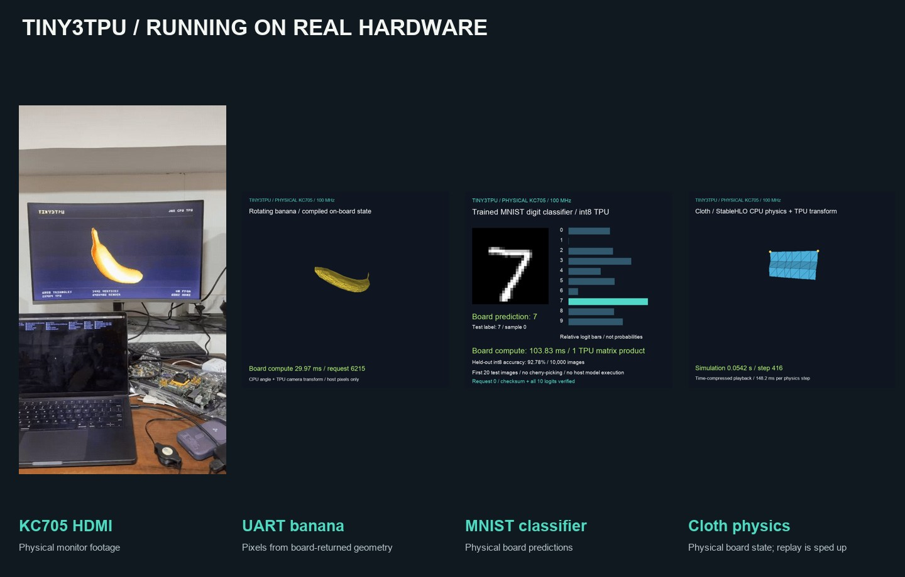

# Demo assets and evidence

These files accompany the [main README](../../README.md). Keep the source labels with the images when sharing them.



## Images and video

| Files | Source and meaning |
| --- | --- |
| [hdmi-board.mp4](hdmi-board.mp4), [GIF](hdmi-board.gif), [poster](hdmi-board.jpg) | Physical KC705 and HDMI monitor footage from [@lazybanananann's post](https://x.com/lazybanananann/status/2109297764739998109), supplied by the repository owner. Original MP4 retained; GIF converted at 12 fps with a 96-color palette. No crop or generated content. |
| [hdmi-rtl.png](hdmi-rtl.png) | HDMI bus pixels from the 6,950-triangle RTL simulation. Not a camera image. |
| [Banana GIF](../showcase/gifs/banana.gif), [poster](banana-poster.png) | 105 unique frames using coordinates returned by the physical KC705. Host-drawn pixels. |
| [Classifier GIF](../showcase/gifs/classifier.gif), [poster](classifier-poster.png) | Predictions from the first 20 MNIST test samples on the physical board. Held 0.8 seconds per image for readability. |
| [Cloth GIF](../showcase/gifs/cloth.gif), [poster](cloth-poster.png) | 51 physical-board samples, after batches of 32 steps. Time-compressed playback; the frames show simulation time and board compute time. |
| [architecture.png](architecture.png) | Diagram of the three published hardware configurations. |
| [attention-timing.png](attention-timing.png) | Chart drawn from the saved physical board measurements. |
| [gallery.jpg](gallery.jpg) | Overview assembled from the physical video poster and the three saved UART-demo frames. |

[video-source.json](video-source.json) records the post, original media URL, file hash and conversion scope. The MP4 is a better download than the larger GIF. The GIF is included so it plays directly in GitHub's README.

Rebuild the diagrams and gallery with Pillow:

```sh
python3 -m pip install Pillow
python3 media/board-demos/make_assets.py
```

Rebuild the GIF from the original video with FFmpeg:

```sh
ffmpeg -i media/board-demos/hdmi-board.mp4 \
  -filter_complex '[0:v]fps=12,split[a][b];[a]palettegen=max_colors=96:stats_mode=diff[p];[b][p]paletteuse=dither=none:diff_mode=rectangle' \
  -loop 0 media/board-demos/hdmi-board.gif
```

## Evidence

- [HDMI physical load](evidence/hdmi-board-load.json), [color confirmation](evidence/hdmi-color-board.json), [implementation](evidence/hdmi-implementation.json), [export](evidence/hdmi-export.json) and [full-rotation RTL check](evidence/hdmi-rtl.json).
- [UART banana and attention checks](../showcase/evidence/physical-check.json).
- [Classifier checks](../showcase/evidence/classifier/physical-check.json), [training report](../showcase/evidence/classifier/training-report.json) and [capture](../showcase/gifs/classifier-capture.json).
- [Banana capture](../showcase/gifs/banana-capture.json), [cloth capture](../showcase/gifs/cloth-capture.json) and [live cloth snapshot](../cloth-thread/board-snapshot.json).

The HDMI load report's `hdmi_observed` field was empty when the programmer finished. That historical record is preserved; the subsequently supplied physical video is separate evidence. The build manifests describe synthesis and export, so their physical-validation fields also remain unchanged.

[provenance.json](evidence/provenance.json) records the original local report hashes. Published copies remove adapter serial numbers and replace local workspace paths with relative paths. Result values are unchanged. Build paths in historical reports identify the original run; they are not files bundled into Git.

These are results from particular images and requests. They do not establish every button, every monitor, long-run numerical stability, or the timing of a freshly rebuilt image. This update includes board demos; the unflashed MuJoCo, higher-resolution display and Ethernet work remains outside this publication.
